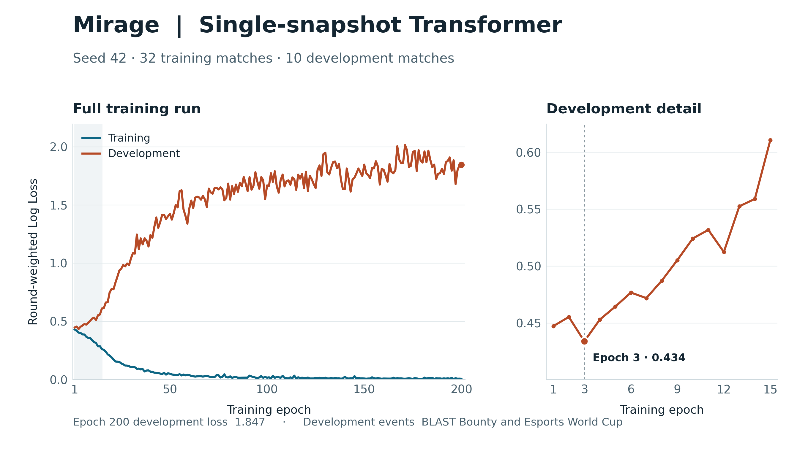

# Mirage model comparisons and temporal experiments

Initial experiment, November 18, 2026. At each sampled tick, the task is to estimate the probability that CT wins the current Mirage round. The controlled comparison asks whether recent snapshots help a small Transformer relative to the same architecture restricted to the current snapshot. Logistic regression establishes the current-state baseline.

## Data and window construction

The experiment reuses the V1 features and targets in `mirage_expanded_2026_v1` and `mirage_holdout_50_v1`. It does not reparse demos. The loader verifies the frozen dataset hashes and joins features and labels one-to-one on `sample_id`. It checks the recording hash, match, map, segment, round number, label, and local tick against the archived round records. A sample must be within `[freeze_end_tick, end_tick)`. The end tick and winner are used to audit the retrospective sample population; the model receives neither of those fields, nor recording IDs, team IDs, or round IDs.

| Role | Events | Matches | Rounds | Targets |
| --- | --- | ---: | ---: | ---: |
| Fit | IEM Rio and IEM Atlanta | 18 | 353 | 6,333 |
| Reserved for calibration | IEM Cologne Major | 14 | 333 | 6,087 |
| Validation and epoch selection | BLAST Open Porto | 2 | 44 | 788 |
| Previously observed exploration | Five later events | 50 | 1,099 | 20,180 |

The partitions are chronological and disjoint by event, match, map and recording. Cologne was reserved; no calibrator was fit and no Cologne scores were used. `pgl-masters-bucharest-2026` remained excluded. The [frozen Phase 2 comparison plan](../configs/phase2_comparison_plan.json) defines the events; the [temporal plan](../configs/phase2_temporal_plan.json) defines the new models, selection rules, and input hashes.

The history model sees the target plus up to seven preceding valid snapshots from the same recording and round. Snapshots are nominally five seconds apart, so eight consecutive samples span 35 seconds; gaps can make the time span longer. Windows are sorted by original tick. A padding mask hides missing positions in short windows, and the current snapshot is always the final token. Neither model sees tokens after its target. The preprocessing uses fit-only medians and scaling, with no extra missingness indicators, so all candidates see the same 47 feature channels. Each target gets inverse round-length weight, giving every round total weight one in fitting and scoring.

## Training and selection

Both Transformers have 70,209 parameters: two encoder layers, hidden size 64, four heads, a 128-wide feed-forward layer, dropout 0.1, and a linear readout of the last token. They use the same initial seed (42), batch order, fixed relative-position encoding, and AdamW settings (batch size 64, learning rate 0.001, weight decay 0.01). The training loop ran 20 epochs per model in FP32 and kept each Transformer’s earliest best Porto log-loss checkpoint. It recorded the winning model and hashes of all checkpoints before loading the 50-match data. The logistic baseline uses `C=1.0` and the same preprocessed current snapshot. All reported comparisons are uncalibrated.

## Results

Scores are round weighted; lower log loss and Brier are better, and higher ROC AUC is better. All three new candidates were scored on the same 788 and 20,180 target IDs, respectively. The existing models are identified separately; the frozen 34-match V1 used Porto to fit, so a Porto score would not be held out.

| Model | Fit matches | Porto log loss | Porto Brier | Porto AUC | Observed 50 log loss | Observed 50 Brier | Observed 50 AUC |
| --- | ---: | ---: | ---: | ---: | ---: | ---: | ---: |
| **Logistic regression (Porto selection)** | 18 | **0.3761** | **0.1222** | **0.9068** | **0.4420** | **0.1484** | 0.8660 |
| Current-snapshot Transformer (epoch 1) | 18 | 0.3910 | 0.1274 | 0.8934 | 0.4469 | 0.1490 | 0.8664 |
| Up-to-eight-snapshot Transformer (epoch 1) | 18 | 0.3965 | 0.1290 | 0.8911 | 0.4474 | 0.1492 | 0.8665 |
| Prior CPU histogram tree, V1 (reference) | 18 | 0.4216 | 0.1374 | 0.8794 | 0.4487 | 0.1486 | 0.8636 |
| Prior frozen V1 logistic regression (reference) | 34 | — | — | — | 0.4321 | 0.1448 | 0.8714 |

History increased log loss by **0.0055** on Porto and **0.00046** on the observed 50 compared with the same architecture given one snapshot. The paired 95% match-cluster bootstrap interval for that 50-match difference is **[−0.00388, +0.00519]** over 2,000 draws; the Brier difference interval is **[−0.00136, +0.00187]**. The small AUC increase on the 50-match set did not improve either probability score. The round-weighted 10-bin expected calibration error there was 0.0296 for logistic, 0.0396 for the snapshot Transformer, and 0.0444 for the history Transformer. No post-training calibration was applied.

On the 12,512 common targets with a full eight-snapshot window, the log losses of the snapshot and history Transformers were 0.34663 and 0.34637 respectively. On the 6,569 targets with two to seven available snapshots, they were 0.58948 and 0.59174. This compares models only within each common subset. The subsets cover different round states and sometimes different rounds, so their absolute scores cannot be read as the effect of adding more snapshots or waiting longer.

The history network’s fitted loss fell from 0.4356 to 0.1015 between epochs 1 and 20, while its Porto loss rose from 0.3965 to 0.8644. The single-snapshot network showed the same divergence (fit: 0.4394 to 0.1874; Porto: 0.3910 to 0.5925). These are signs of overfitting this small fit/validation setup. This run provides no clear probability benefit from history with these aggregate V1 features and this configuration. It does not rule out a benefit with more training events, better regularization, or other temporal features.

Porto represents two matches from one event, all overlapping windows from each round are dependent, and only one training seed was used. The bootstrap resamples matches with all their rounds and ticks; it does not capture between-event or training-seed uncertainty. The 50-match dataset had already been studied and is retrospective. The next priority is broader event-level validation, followed by a new unseen event after fixing models, seeds and scoring rules.

## CUDA verification and reproduction

The [official PyTorch CUDA 13.0 wheel](https://pytorch.org/get-started/previous-versions/#v2110) is locked as the optional `temporal` extra for Windows/Linux. The run used Python 3.12.14, PyTorch 2.11.0+cu130, NVIDIA driver 621.01, and an RTX 4070 Ti (12 GB, `cuda:0`). It requires CUDA and does not fall back to CPU. The standalone real-data smoke test verified a finite FP32 forward pass, a nonzero CUDA gradient, and a parameter update. Its first full epoch took 1.12 seconds across 99 batches, peaking at 72.1 MiB allocated (92 MiB reserved by PyTorch). The full two-model run peaked at 72.3 MiB allocated. These memory figures describe PyTorch’s allocator, not total GPU memory in use. Reloading both selected checkpoints reproduced the validation probabilities exactly on this machine.

Run from the repository root with the archived datasets and their processed round records in place. Use fresh output paths. [Required files](../data/README.md#archived-temporal-inputs)

```sh
uv sync --frozen --extra dev --extra ml --extra context --extra temporal
uv run --frozen --no-sync python -m cs2_pipeline.phase2_temporal --dataset data/datasets/mirage_expanded_2026_v1 --out models/temporal_smoke_recheck --smoke-test
uv run --frozen --no-sync python -m cs2_pipeline.phase2_temporal --dataset data/datasets/mirage_expanded_2026_v1 --out models/temporal_full_recheck --progress-file runs/temporal_full_recheck/progress.jsonl
uv run --frozen --no-sync python -m pytest -q
uv run --frozen --no-sync ruff check code/src scripts tests
```

Add `--extra gpu` to `uv sync` if retaining the separate XGBoost experiment in the same environment. To launch from the dashboard, run `uv run --frozen --no-sync python -m cs2_pipeline.monitor` and select **Mirage · 时序 Transformer 对照**. The existing dashboard records epochs through its progress stream.

The original local run is in `models/monitor_runs/20261118T051803-7248d43d/`. Its report contains split counts, preprocessing, scores, epoch timings, and hashes. The separate smoke report is in `models/phase2_temporal_cuda_smoke_20261118/`. Verification checked target IDs, labels, ticks, weights and window lengths before recomputing the metrics from the saved predictions. [Public run summary](../results/mirage_temporal_initial.json)

## Follow-up: identical 34-map training set (November 21, 2026)

The 18-map experiment isolates window length. This follow-up tests the algorithm comparison at the traditional V1 training size. The fitted logistic regression and both Transformer variants use the exact archived training IDs: **34 matches, 730 rounds, 13,208 targets**, from Rio (17), Atlanta (1), Cologne (14) and Porto (2). Logistic and Transformers use identical fit-only imputation and scaling, the same 47 V1 channels, and one total weight per round. The frozen V1 logistic regression and CUDA XGBoost are additional references fit on the same rows, with their original preprocessing and hyperparameters. Cologne and Porto are in training for this experiment, so neither is used for calibration or evaluation here.

Both Transformers kept their original architecture. They were trained for one epoch, as selected in the earlier 18-match Porto comparison, with seed 42 as the primary result and seeds 7 and 2026 as sensitivity checks. All six fits ran in FP32 on the RTX 4070 Ti and were saved before the scoring process read the evaluation set. The evaluation comprises the previously observed 50 matches, 1,099 rounds and 20,180 aligned targets. The match IDs, event IDs and recording hashes do not overlap the fit rows. This is a retrospective comparison; `pgl-masters-bucharest-2026` remains reserved.

| Model (all 34 fit maps) | Log Loss | Brier | ROC AUC |
| --- | ---: | ---: | ---: |
| Matched logistic regression | 0.4322 | 0.1448 | 0.8713 |
| Single-snapshot Transformer, seed 42 | 0.4348 | 0.1455 | 0.8695 |
| Up-to-eight-snapshot Transformer, seed 42 | 0.4386 | 0.1472 | 0.8669 |
| Original frozen V1 logistic (reference) | 0.4321 | 0.1448 | 0.8714 |
| Original CUDA XGBoost (reference) | 0.4435 | 0.1465 | 0.8682 |

The primary single-snapshot and history models had higher point-estimate log loss than the matched logistic regression by +0.00258 and +0.00636. Their respective 95% paired match-bootstrap intervals were [−0.00391, +0.00927] and [−0.00191, +0.01507]. The single-snapshot Transformer had lower log loss than the archived XGBoost model in this cohort (difference −0.00867; interval [−0.01655, −0.00040]). These are within-cohort intervals, not estimates of between-event uncertainty, and no claim is made about the relative performance of other architectures or tuning settings.

History minus single-snapshot log loss was +0.00378 for seed 42, +0.00048 for seed 7, and −0.00318 for seed 2026. The 34-match comparison gives no stable reason to prefer the historical window. Its conclusion is limited to these features, train size and training schedule. A future increase in training volume should apply equally to every model; a prospective evaluation should use an event held outside fitting and model selection for all models.

Reproduce with fresh paths using the CUDA installation above:

```sh
uv run --frozen --no-sync python -m scripts.fit_matched34_transformers --out models/matched34_fit_recheck --progress-file runs/matched34_fit_recheck/progress.jsonl
uv run --frozen --no-sync python -m cs2_pipeline.matched34_score --fit-dir models/matched34_fit_recheck --dataset data/datasets/mirage_holdout_50_v1 --out models/matched34_score_recheck --progress-file runs/matched34_score_recheck/progress.jsonl
```

The local receipts are `models/matched34_transformers_fit_v1/fit.json` and `models/matched34_observed50_v1/report.json`. The latter records per-event scores, paired intervals, and the hash of the saved prediction table. The pooled scores and intervals are in the [published results](../results/mirage_followup_20261121.json).

## Training duration

We ran 200 epochs per seed on 32 Rio, Atlanta, and Cologne maps (686 rounds and 12,420 targets). We selected the earliest minimum of round-weighted development log loss for each seed using 10 previously observed BLAST Bounty and Esports World Cup maps (214 rounds and 3,945 targets). We then added the two Porto maps and refitted on the same 34 maps for both models. Selection was frozen before refitting and before loading the previous 50-map cohort for retrospective scoring. [Historical development data](mirage_historical_validation_20261118.md) · [Epoch plan](../configs/mirage_snapshot_epochs.json)

| Seed | Selected epoch | Epoch 1 log loss | Selected log loss | Epoch 200 log loss | Selected minus logistic, 95% CI |
| ---: | ---: | ---: | ---: | ---: | --- |
| 42 | 3 | 0.43478 | 0.44695 | 1.65741 | +0.01475 [+0.00734, +0.02263] |
| 7 | 1 | 0.44684 | 0.44684 | 1.61030 | +0.01464 [+0.00595, +0.02326] |
| 2026 | 2 | 0.43969 | 0.44482 | 1.58522 | +0.01261 [+0.00441, +0.02026] |

The matched logistic baseline scored **0.43220** on the same 50 maps. In the development fit, seed 42's training loss fell from 0.43030 at epoch 1 to 0.00680 at epoch 200, while its development loss rose from 0.43393 at its epoch-3 minimum to 1.84657 at epoch 200. All three seeds showed this divergence, and the three selected checkpoints had higher retrospective log loss than logistic regression. The intervals use 2,000 paired resamples of whole matches and describe variation within the observed cohort.



## Training set size and event expansion

Two event-stratified draws used nested 16- and 24-map subsets of the same 32-map fit. Each draw and seed was scored on the same 10 development maps. From 16 to 32 maps, logistic regression's log loss fell in both draws. All six paired intervals for the change in the epoch-1 Transformer gap to logistic regression included zero. Each of the 15 trajectories had lower training loss and higher development loss at epoch 20 than at epoch 1. A fixed batch size gives larger fits more optimizer steps per epoch. [Training size plan](../configs/mirage_train_size.json) · [Learning curves](../results/figures/mirage-training-size.png)

The expansion added 15 verified Rotterdam and Astana maps to the 32-map fit. One of the 16 planned archives was unavailable (`hltv:2394133`). The larger fit had 47 maps, 1,035 rounds, and 18,672 targets, and used the same development data and features for both candidates. [Expansion roster and protocol](../configs/mirage_train_expansion_20261121.json)

| Candidate | 32-map fit log loss | 47-map fit log loss |
| --- | ---: | ---: |
| Matched logistic regression | 0.43455 | 0.42124 |
| Single-snapshot Transformer, epoch 1, seed 42 | 0.44729 | 0.41753 |
| Single-snapshot Transformer, epoch 1, seed 7 | 0.42628 | 0.41947 |
| Single-snapshot Transformer, epoch 1, seed 2026 | 0.45657 | 0.44726 |

With 47 fit maps, the seed-42 gap to logistic regression was **−0.00372** (95% CI [−0.01870, +0.01153]). The gap varied across seeds, and all three intervals for the change in gap from 32 to 47 maps included zero. The expansion changes the training event mix as well as the sample size.

## Dropout ablation

Dropout 0.10 and 0.20 were compared on the 47-map fit and the same 10 development maps. Both settings selected epoch 2 by minimum mean development log loss across seeds 42, 7, and 2026. The adoption rule required improvement in the pooled cohort and each of the two events. [Dropout plan](../configs/mirage_dropout.json) · [Learning curves](../results/figures/mirage-dropout.png)

| Cohort | Dropout 0.10 | Dropout 0.20 | Change from 0.10 to 0.20, 95% CI |
| --- | ---: | ---: | --- |
| Pooled (10 maps) | 0.42091 | 0.42077 | −0.00014 [−0.00191, +0.00222] |
| BLAST Bounty (3 maps) | 0.43090 | 0.42945 | −0.00145 [−0.00240, +0.00028] |
| Esports World Cup (7 maps) | 0.41711 | 0.41747 | +0.00036 [−0.00224, +0.00316] |

At epoch 20, the three-seed mean development loss was 0.58638 for dropout 0.10 and 0.49265 for dropout 0.20. The higher dropout reduced late overfitting. Its increase in Esports World Cup log loss at the selected epoch failed the adoption rule, so the prospective candidate retains dropout 0.10.

## Frozen Singapore evaluation

On November 21, 2026, the final comparison was frozen after adding Porto back to the 47-map fit. Both models used **49 maps, 1,079 rounds, and 19,460 targets**. The primary candidate is the single-snapshot Transformer with seed 42, epoch 1, and dropout 0.10. The baseline is matched logistic regression with `C=1.0`. Sensitivity fits use seeds 7 and 2026. The development-selected checkpoints at epochs 1, 2, and 7 for seeds 42, 7, and 2026 are secondary diagnostics.

The evaluation will use all identity- and score-verified PGL Major Singapore 2026 Mirage maps played after the freeze. Singapore is outside fitting and development. The primary contrast is round-weighted log loss for Transformer minus logistic, with 2,000 paired bootstrap draws by match. Brier score and ROC AUC are secondary. Scoring is pending. Bucharest remains excluded. The receipt identifies the locked configuration and checkpoint hashes. [Freeze receipt](../results/mirage_singapore_freeze_20261121.json)

## Follow-up reproduction

Use the CUDA environment above and the original [archived inputs](../data/README.md#archived-temporal-inputs). The fit and score steps below share an output directory within each run. Start each experiment in a fresh directory.

| Experiment | Entry points from the repository root | Previous local artifacts |
| --- | --- | --- |
| Matched 34 maps | [Fit and score commands](#follow-up-identical-34-map-training-set-november-21-2026) | The original Porto selection, training dataset, and traditional reference predictions |
| Training duration | [`scripts.fit_mirage_snapshot_epochs both`](../scripts/fit_mirage_snapshot_epochs.py), then [`scripts.score_mirage_snapshot_epochs`](../scripts/score_mirage_snapshot_epochs.py) | The matched 34-map predictions and 10-map development dataset |
| Training set size | [`scripts.fit_mirage_train_size`](../scripts/fit_mirage_train_size.py), then [`scripts.score_mirage_train_size`](../scripts/score_mirage_train_size.py) | The frozen 32-map fit and development fingerprints from the epoch experiment |
| Training expansion | [`scripts.import_mirage_train_expansion`](../scripts/import_mirage_train_expansion.py), then [`scripts.fit_mirage_train_expansion`](../scripts/fit_mirage_train_expansion.py) with `--intake` | The frozen size experiment and supplemental replay archives listed in the expansion plan |
| Dropout | [`scripts.fit_mirage_dropout`](../scripts/fit_mirage_dropout.py), then [`scripts.score_mirage_dropout`](../scripts/score_mirage_dropout.py) | The original expansion freeze, intake receipt, and archived development curves |

For example, repeat the training-duration run from the repository root with the verified inputs in place.

```sh
uv run --frozen --no-sync python -m scripts.fit_mirage_snapshot_epochs both --out models/mirage_epochs_recheck --progress-file runs/mirage_epochs_recheck/progress.jsonl
uv run --frozen --no-sync python -m scripts.score_mirage_snapshot_epochs --out models/mirage_epochs_recheck --progress-file runs/mirage_epochs_recheck/progress.jsonl
```

The plans pin hashes of the original intermediate runs, so downstream stages require the named archived inputs. The published tables, figures, and aggregate scores are available in the [results index](../results/README.md).
